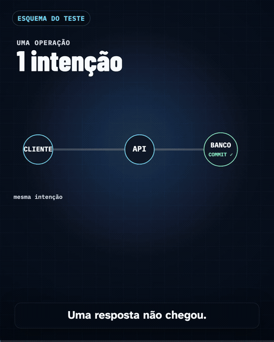
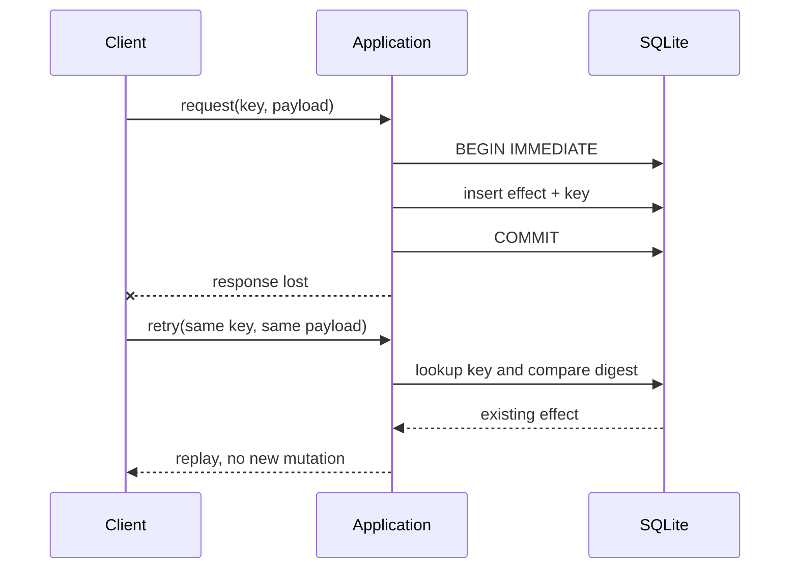

# Post-Commit Retry & Idempotency Lab

[](https://www.python.org/)
[](LICENSE)

A reproducible Python and SQLite lab showing a failure mode that is easy to miss:
the database commits successfully, the response is lost, and the client retries the
same intent.

The project compares an unprotected retry with an idempotency contract that stores
the stable key and the effect in the same transaction. It also rejects reuse of the
same key with a different payload and exercises concurrent calls.



## What the experiment proves

| Scenario | Attempts | Persisted effects | Result |
| --- | ---: | ---: | --- |
| Retry without a stable key | 2 | 2 | Duplicate effect |
| Retry with the same key and payload | 2 | 1 | Replay recognized |
| Same key with a different payload | 1 divergent attempt | 1 | Conflict rejected |
| Concurrent calls with the same key | 2 callers | 1 | Single effect |

The key is not a generic permission token. It is bound to the canonical SHA-256 of
the payload. Reusing the key with different content raises an explicit conflict.



## Run locally

Requirements: Python 3.12 or newer and [uv](https://docs.astral.sh/uv/).

```console
uv sync --extra dev
uv run pytest
```

Generate deterministic JSON and CSV evidence:

```console
uv run python -m agent_retry_lab demo --output-dir ./demo-output
```

The output contains the three scenario results, a summary and a SHA-256 manifest.
Files do not contain timestamps, so repeated runs are byte-for-byte deterministic.

Run the browser demonstration used in the video:

```console
uv run python -m agent_retry_lab serve --database ./demo.sqlite --port 8765
```

Open [http://127.0.0.1:8765](http://127.0.0.1:8765). The interface is in Brazilian
Portuguese and reads the persisted `effects` rows after each execution.

The public API can also be called directly:

```python
from agent_retry_lab import run_operation

result = run_operation(
    "lab.sqlite",
    operation_id="ticket-001",
    payload={"action": "open", "ticket": "TCK-001"},
    mode="idempotent",
)

assert result["attempts"] == 2
assert result["effect_count"] == 1
assert result["replayed"] is True
```

## Illustrated pattern

The naive mode writes an effect, commits and simulates a response lost after the
commit. Because the client cannot know that the mutation is durable, it retries and
creates a second effect.

The idempotent mode uses `operation_id` as a stable key. The key record and the effect
are inserted before the same commit. A retry finds the key, compares the canonical
payload digest and converges on the original effect.

`BEGIN IMMEDIATE` serializes writers in this SQLite lab. Tests verify that concurrent
calls with the same key create only one effect. The lab also verifies rollback when
the key insert fails, non-finite number rejection, string-only object keys and cycle
detection before any mutation.

## Production limits

This is a focused local experiment, not a production component. It demonstrates one
transactional boundary inside one SQLite database. It does **not** claim exactly-once
delivery over a network.

A production design still needs explicit decisions for:

- idempotency-key ownership, scope, retention and expiration;
- isolation level and contention behavior of the selected database;
- response persistence and replay semantics;
- external side effects that cannot share the database transaction;
- authentication, authorization, rate limiting and abuse prevention;
- observability, migrations, disaster recovery and operational SLAs.

All identifiers and payloads in this repository are fictitious. No corporate or
personal production data is included.

## Project structure

```text
src/agent_retry_lab/   Core operation, deterministic demo and local web interface
tests/                 Behavioral, concurrency, rollback, API and documentation tests
docs/                  Public demonstration assets
```

## License

[MIT](LICENSE)
